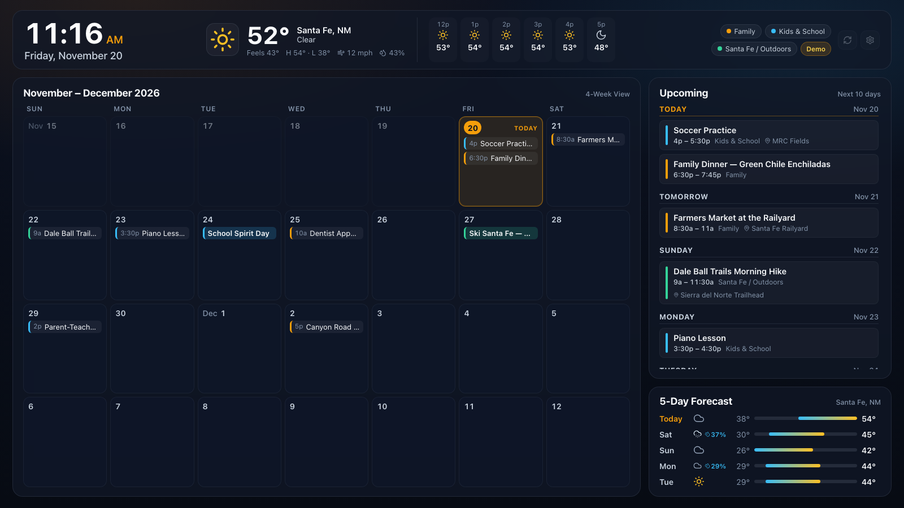

# Homeboard

A self-hosted DakBoard replacement for Raspberry Pi displaying your family's calendars and live weather for **Santa Fe, NM** on a 16:9 landscape wall display.



## Features

- **Private iCal / ICS Calendars** — Works with Google Calendar, Apple iCloud, Outlook, and Cozi with zero OAuth setup. Supports recurring events (`RRULE`, `EXDATE`), all-day/multi-day events, and color coding per family member.
- **Santa Fe, NM Weather** — Current conditions, feels-like, wind, humidity, hourly forecast strip, and 5-day forecast with temperature range bars (powered by free, no-API-key [Open-Meteo](https://open-meteo.com/)).
- **4-Week Rolling / Month Grid + Upcoming Agenda** — Designed for across-the-room legibility on 16:9 displays.
- **Phone-Friendly Settings UI** — Open `http://<pi-ip>:3000/settings` from any phone or laptop on your Wi-Fi to add/test calendars, pick colors, and tweak display preferences.
- **Kiosk Ready** — Auto-hiding cursor, overnight dimming schedule, subtle burn-in pixel shift, offline cache resilience, and one-command Raspberry Pi systemd + Chromium kiosk setup.

---

## Quick Start (Local Development)

```bash
npm install
npm run dev
```

- Dashboard: `http://localhost:5173`
- Settings: `http://localhost:5173/settings`
- Backend API: `http://localhost:3000`

Production build & run locally:

```bash
npm run build
npm start
# Open http://localhost:3000
```

---

## Deploying to Raspberry Pi

1. Flash **Raspberry Pi OS with Desktop** (64-bit recommended) using Raspberry Pi Imager, and configure Wi-Fi + SSH + auto-login to Desktop.
2. Copy or clone this repo onto your Pi (e.g. `~/homeboard`):
   ```bash
   git clone https://github.com/bsharpe/homeboard.git ~/homeboard
   cd ~/homeboard
   ```
3. Run the installer:
   ```bash
   chmod +x pi/install.sh
   ./pi/install.sh
   ```
4. Reboot to launch full-screen kiosk mode automatically:
   ```bash
   sudo reboot
   ```
5. From your phone or laptop on the same Wi-Fi, open `http://<pi-ip>:3000/settings` (or `http://homeboard.local:3000/settings` if your Pi hostname is `homeboard`) to paste your family's private ICS calendar links.

---

## Finding Your Private ICS Calendar Links

- **Google Calendar:** Open [calendar.google.com](https://calendar.google.com) → hover over a calendar → **Settings and sharing** → scroll to **Integrate calendar** → copy **Secret address in iCal format**.
- **Apple iCloud:** Open [icloud.com/calendar](https://www.icloud.com/calendar) → click the share icon next to a calendar → enable **Public Calendar** → copy the link (`webcal://` links are converted automatically).
- **Outlook / Cozi:** Open calendar sharing/publish settings and copy the `.ics` link.

---

## Keyboard Shortcuts (on the Display)

- `S` — Open Settings
- `R` — Force refresh calendars & weather

## Configuration File

Settings are stored in `data/config.json` (created automatically on first boot). You can edit it via `/settings` or directly on disk.
